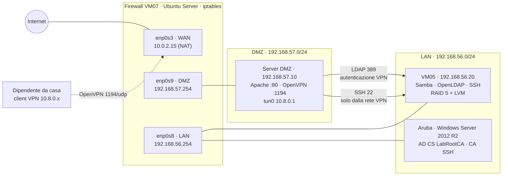
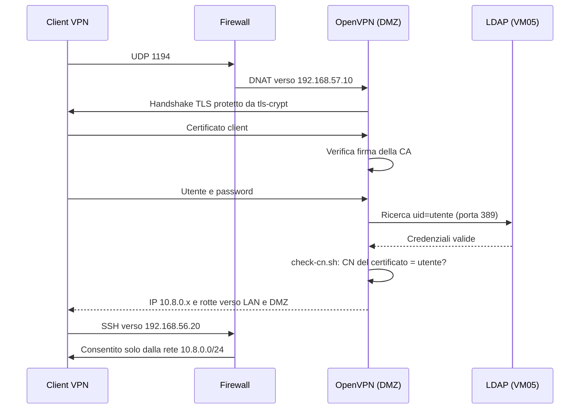
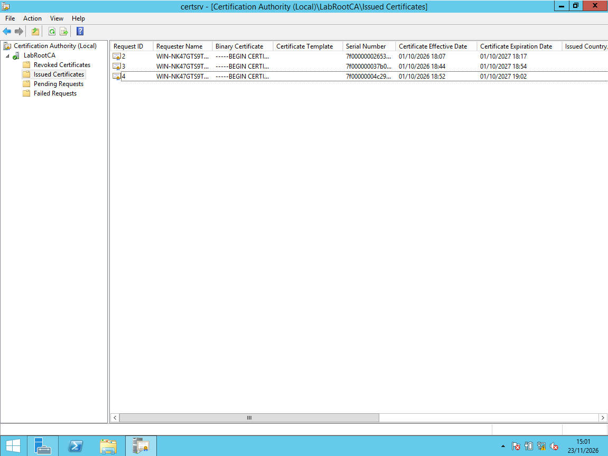

# Infrastruttura di rete aziendale – Laboratorio

Progetto di laboratorio che simula la rete di una piccola azienda, realizzato con VirtualBox e progettato in Cisco Packet Tracer. Una rete divisa in **WAN, LAN e DMZ**, protetta da un **firewall iptables**, con un **sito web pubblico**, una **VPN a due fattori** come unico accesso remoto, un **file server Samba con autenticazione LDAP** su storage **RAID 5 + LVM** e una **PKI** con Certification Authority Windows e CA SSH.

## Schema di rete



Il file Packet Tracer con la topologia è in [`docs/PROGETTO.pkt`](docs/PROGETTO.pkt).

| Macchina | Sistema | Indirizzo | Ruolo |
| --- | --- | --- | --- |
| Firewall (VM07) | Ubuntu Server | WAN 10.0.2.15 · LAN .56.254 · DMZ .57.254 | Router e firewall tra le tre reti |
| Server DMZ | Ubuntu Server | 192.168.57.10 | Sito web Apache, server OpenVPN |
| VM05 | Ubuntu Server | 192.168.56.20 | File server Samba, directory OpenLDAP, server SSH |
| Aruba | Windows Server 2012 R2 | LAN | Certification Authority (AD CS) e CA SSH |

## 1. Firewall

Configurazione completa: [`configs/firewall/iptables-rules.v4`](configs/firewall/iptables-rules.v4)

- **Policy di default DROP** su INPUT e FORWARD: passa solo il traffico autorizzato esplicitamente.
- **Anti-spoofing** nella tabella `raw`: ogni interfaccia accetta solo gli indirizzi della propria rete; vengono scartati, per esempio, pacchetti con IP della LAN che arrivano dalla WAN.
- **Pacchetti anomali** scartati nella tabella `mangle`: stato INVALID e nuove connessioni TCP che non iniziano con SYN.
- **NAT**: MASQUERADE verso Internet e **DNAT** delle porte 80/tcp e 1194/udp verso il server della DMZ.
- **QoS**: marcatura DSCP del traffico SSH.
- **Log** delle nuove connessioni SSH e del traffico bloccato, con limite di frequenza.

Flussi consentiti:

| Da | Verso | Porta | Motivo |
| --- | --- | --- | --- |
| Internet | Server DMZ | 80/tcp | Sito web pubblico |
| Internet | Server DMZ | 1194/udp | VPN |
| Server DMZ | VM05 | 389/tcp | Verifica utenti VPN su LDAP |
| Rete VPN 10.8.0.0/24 | VM05 | 22/tcp | Accesso amministrativo via SSH |
| LAN | Internet, DMZ | tutte | Navigazione e gestione |
| DMZ | Internet | tutte | Aggiornamenti |
| Internet, DMZ | LAN | – | **Bloccato** (tranne i due flussi sopra) |

## 2. DMZ: sito web e VPN a due fattori

Configurazione: [`configs/dmz/openvpn/`](configs/dmz/openvpn/)

La VPN è l'**unico accesso dall'esterno verso la rete interna** e richiede due fattori:

1. **Certificato client** firmato dalla CA della VPN (`remote-cert-tls client`).
2. **Utente e password LDAP**, verificati sulla VM05 dal plugin `openvpn-auth-ldap`: sono le stesse credenziali del file server.
3. **Controllo incrociato** con lo script [`check-cn.sh`](configs/dmz/openvpn/check-cn.sh): il nome nel certificato deve coincidere con l'utente che fa il login, quindi un utente non può usare il certificato di un collega.



Altre impostazioni: cifratura **AES-256-GCM**, chiave **tls-crypt** contro scansioni e attacchi DoS sull'handshake, servizio eseguito come utente `nobody`. Un profilo client d'esempio, senza chiavi, è in [`client-esempio.ovpn`](configs/dmz/openvpn/client-esempio.ovpn).

Il server Apache pubblica il sito (per ora una pagina di prova) sulla porta 80, inoltrata dal firewall.

## 3. VM05: file server Samba con LDAP

### Storage: RAID 5 + LVM

Quattro dischi da 10 GB, ognuno diviso in due partizioni, formano **due array RAID 5**. Ogni array può perdere un disco senza perdere dati. Sopra, LVM crea i volumi delle condivisioni ([dettagli](configs/vm05-samba-ldap/storage/)):

| Array RAID 5 | Partizioni | Volume group | Volumi logici | Punto di montaggio |
| --- | --- | --- | --- | --- |
| md0 (15 GB) | sdb1, sdc1, sdd1, sde1 | A | musica 7 GB, film 8 GB | /mnt/musica, /mnt/film |
| md1 (15 GB) | sdb2, sdc2, sdd2, sde2 | B | doc 15 GB | /mnt/doc |

### Autenticazione centralizzata

- **OpenLDAP** (`dc=nodomain`) contiene utenti e gruppo `people`, con classi `posixAccount` (account Linux) e `sambaSamAccount` (account Samba): [directory senza password](configs/vm05-samba-ldap/ldap/directory-senza-password.ldif).
- Linux riconosce gli utenti LDAP tramite NSS (`nsswitch.conf`).
- **Samba** usa LDAP come database degli utenti (`passdb backend = ldapsam`) e condivide le tre cartelle solo al gruppo `people`: [smb.conf](configs/vm05-samba-ldap/samba/smb.conf).
- L'overlay **smbk5pwd** sincronizza in automatico la password Samba quando si cambia quella LDAP. Ubuntu non lo include nei pacchetti, quindi è stato **compilato da sorgente**.

### Accesso SSH solo con certificato

Il server accetta solo certificati SSH firmati dalla CA (`TrustedUserCAKeys`) e ha il **login con password disattivato**: [sshd_config](configs/vm05-samba-ldap/ssh/).

## 4. PKI: Certification Authority

### AD CS – LabRootCA

Su Windows Server 2012 R2 è installata una **CA radice Standalone** (`LabRootCA`) con Active Directory Certificate Services. La CA genera centralmente le coppie di chiavi e i certificati, poi li installa sui dispositivi.

| ID | Certificato | Uso | Validità |
| --- | --- | --- | --- |
| 2 | ubuntu-server | Certificato host del server Ubuntu | 01/10/2026 – 01/10/2027 |
| 3 | utente3 | Certificato client | 01/10/2026 – 01/10/2027 |
| 4 | utente | Certificato client dell'amministratore | 01/10/2026 – 01/10/2027 |



### CA SSH

Una seconda CA, di tipo OpenSSH, firma le chiavi degli utenti. Ogni certificato vale solo per l'account Linux indicato (principal) e ha una scadenza: [certificati SSH](configs/aruba-ca/ssh-ca/certificati-ssh.md).

### Hardening del server Windows

- Rimosso **SMB 1.0**, protocollo obsoleto e vulnerabile (sfruttato da WannaCry), non necessario per la CA.

## Problemi risolti durante il progetto

- **Samba non autenticava gli utenti LDAP** (`NT_STATUS_INVALID_SID`): gli utenti creati da Webmin erano solo `inetOrgPerson`. Ho aggiunto gli attributi `posixAccount` e `sambaSamAccount`, l'oggetto `sambaDomain` con il SID corretto e la mappatura del gruppo `people`.
- **Password diverse tra LDAP e Samba**: risolto con l'overlay smbk5pwd, compilato da sorgente perché assente nei pacchetti Ubuntu.
- **Login SSH con password ancora attivo** nonostante la CA: il file `sshd_config.d/50-cloud-init.conf` lo riattivava ed era letto prima di `sshd_config`. Corretto e verificato con `sshd -T`.
- **Disco di sistema pieno sulla VM05**: liberato spazio pulendo cache dei pacchetti e journal.

## Possibili miglioramenti

- Cifrare il traffico LDAP (LDAPS o StartTLS) tra server VPN e VM05.
- Pubblicare il sito anche in HTTPS con un certificato della CA.
- Limitare la porta 1194 agli IP aziendali noti.
- Conservare le chiavi private delle CA offline o con permessi ristretti.
- Monitorare i log del firewall con un SIEM.

## Struttura del repository

```
configs/
├── firewall/          regole iptables, netplan, stato della rete
├── dmz/               OpenVPN (server, LDAP, check-cn.sh, client d'esempio), Apache
├── vm05-samba-ldap/   Samba, LDAP, storage RAID/LVM, SSH
└── aruba-ca/          informazioni CA, certificati emessi, CA SSH
docs/                  schema Packet Tracer e screenshot
```

Nessuna chiave privata o password è pubblicata: dove servono ci sono segnaposto come `<CHIAVE_PRIVATA_CLIENT>`.

## Tecnologie

Ubuntu Server · iptables · Netplan · OpenVPN · OpenLDAP · Samba · mdadm (RAID 5) · LVM · OpenSSH · Apache · Windows Server 2012 R2 · AD CS · VirtualBox · Cisco Packet Tracer

## Autore

**Matteo Grossi** – Sistemista junior · Cybersecurity, Roma
